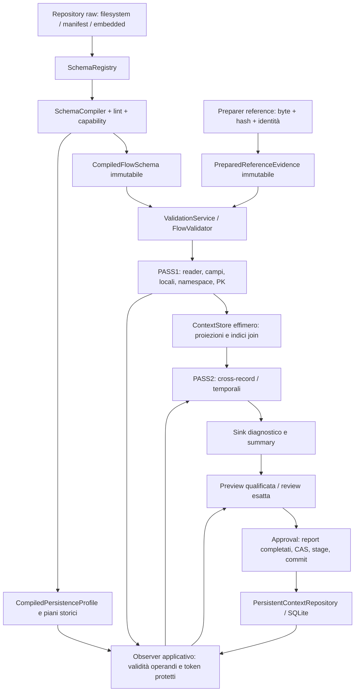

# LINTRA — audit ingegneristico retrospettivo post-M9

Data: 10 novembre 2026, Europe/Rome. Mandato straordinario dell'autore, esecuzione
single-agent e sequenziale. Registro distinto dalle 140 task del piano.

## 1. Executive summary

La baseline M9 è ricostruibile e il prodotto dispone di prove reali, comprese
esecuzioni CAD83/C1/L1, transazioni SQLite, crash di processo e confronti nativi.
M9 non garantisce assenza di difetti: questa revisione ha riprodotto **due bug
SQLite** sfuggiti alla qualifica precedente e li ha corretti con due regressioni.
Una frase obsoleta nel README è stata corretta separatamente dal comportamento.

Il giudizio è **affidabilità sostenuta da evidenze per i percorsi e i profili
qualificati, con readiness sanitaria operativa ancora da deliberare**. Non è
possibile estendere tale giudizio al SIOC regionale completo, alla gestione CAD
da GUI, alla resistenza a perdita di alimentazione o a dati reali. Le capacità
effettive sono nella matrice §4; i prerequisiti residui sono nel
[registro separato](LINTRA_POST_M9_GAP_REGISTER.md).

La revisione cerca guasti nel codice e valuta le prove, senza riaprire task DONE
per il solo fatto che hanno un limite approvato. Nessuna nuova norma, dipendenza,
migrazione, soglia, funzione storica delle interfacce, release o freeze.

## 2. Baseline verificata e provenienza

Repository principale `/home/alberto/Desktop/LINTRA/lintra`, remoto
`UraganoAngelina/lintra`, branch `work/p1-foundations`. Working tree iniziale
pulita; nessuna modifica dell'autore da separare. Le directory adiacenti
`lintra-data` e `lintra-sqlite-recovery-20261106` sono checkout distinti e non
sono state modificate. `docs/migration` è esclusa e preservata.

| Elemento | Riscontro |
|---|---|
| HEAD iniziale | `bfe51ac08c23b81244f736488c3996087fa8b2de` |
| Codice CAD12 qualificato | `d45078e153ba0455774129c9832c98eb9e90b789`, antenato effettivo |
| Chiusura documentale | `c6aa6e024bb7f8d8f5830bb107bd2bb76033dd2b`, antenato effettivo |
| Differenza prodotto d45078e→HEAD iniziale | Vuota per src/ui/tests/scripts/xtask/Cargo/CI/bundles; differenze documentali separate |
| CI storica | `42641969728`, API riletta: completed/success, SHA d45078e, sette job richiesti success e packaging UI opzionale skipped |
| Stato piano | Frontiera iniziale 140/140 DONE, QG-8/M9 raggiunti, nessuna READY; registri sottostanti storici |
| Correzioni dell'audit | `af3bcccb6246a7ff00463c595f4c780a9f5c5195` |
| CI delle correzioni | `42789338814`, completed/success su af3bccc; sette job richiesti positivi, UI packaging opzionale skipped |
| Ambiente locale | Linux x86_64 CachyOS, kernel 7.3.1, Rust/Cargo 1.99.1; compilazione con lock e cache offline |

[Baseline riproducibile](docs/verification/post-m9-audit/baseline.json),
[API CI storica](docs/verification/post-m9-audit/historical-ci-live.json),
[manifest input qualificati](docs/verification/post-m9-audit/qualified-inputs.json)
e [dipendenze effettivamente risolte](docs/verification/post-m9-audit/dependencies.json).
Il lock workspace contiene 543 package, non 543 dipendenze dirette. Esempi:
rusqlite 0.41.0 con bundled/cache/hooks, libsqlite3-sys 0.39.1 e amalgamation
SQLite 3.54.1; Slint 1.18.1; sha2 0.11.1,
hmac 0.13.0, zeroize 1.9.1, chrono 0.4.45, tempfile 3.27.0,
rust_xlsxwriter 0.100.0. Il lock separato xtask contiene 94 package, inventariati
in tooling-dependencies.json. Nessun aggiornamento delle dipendenze nell'audit.

## 3. Metodo, contratti consultati e perimetro

Fasi: ricostruzione architetturale; ispezione critica con scenari di guasto;
riproduzioni prima della correzione; modifiche minime; regressioni/gate;
registro e handoff decisionale. I conteggi di test sono esiti dei riepiloghi,
inclusi sottoprocessi, e non una misura della completezza della copertura.

Fonti applicate: AGENTS.md, MASTER_AGENT_PROMPT, piano §4/14/15/16 e persistenza,
TASK_DEPENDENCY_MAP/ATOMIC_TASKS_INDEX, frontiera corrente di IMPLEMENTATION_STATUS;
ARCH §§17–23/39/45; DET §§79/115/166–174; PERSISTENCE_CORE_SPEC e registro formati;
ADR-PERSIST-002; ratifica provisioning e PERSISTENCE_OPERATIONS;
ADR-HISTORY-EXISTENCE contratto implementativo, C1 e L1;
CNF-DIAGNOSTIC-ORDER-01; CNF-CAD-NAMESPACE-BINDING-01;
CNF-REFERENCE-FORMAT-01; DEC-SIOC-HIST-01 e ratifica SIOC referenziale G0;
DEC-14/PERFORMANCE e DEC-17 finale; dossier CAD12 e P18-04;
ledger G0/SIOC e descrizione del candidato CAD. Documenti normativi e decisioni
sono confrontati attraverso le formalizzazioni e i mapping versionati pertinenti;
non viene ripetuta una certificazione indipendente dell'intera fonte normativa.

| Area ispezionata | Codice e proprietà cercate | Prove esaminate |
|---|---|---|
| Persistenza | sqlite/mod.rs, codec.rs, history.rs, file_security/key, protection; CAS, receipt, guard autocommit, scope, manifest, ordinal, versioni | Test adapter/metadata/history/qualification, session_approval, persistence_protection, repository, copie chiuse |
| Compiler/DSL | raw, compiled, compiler, linter, registry/repository, expression, joins, rule_dependencies, namespace_binding, history_existence, temporal | schema_compiler/compatibility/registry, derived/expression, namespace_bindings, golden |
| Engine | flow_execution/flow_validator, record/field pipeline, projected/temporal context, inactivity_calendar, trace_validator | diagnostic_order, max_errors, cancellation_progress, cross_record, CAD componenti e CAD83, history_existence |
| Reference | filesystem/preparer/evidence/membership, preparazione e uso immutabile | reference_filesystem/preparation/service, embedded_backends, CAD lookup |
| Input/privacy/report | reader/source/audit, summary/error_budget, atomic, CSV, XLSX, spool | robustness, input matrix/BOM/audit, sink failure/atomic, CSV/XLSX e sentinelle storage |
| Adapter/distribuzione | CLI historical/command/args/review, UI analysis/worker/controller/export, workflow CI, tooling release | cli_history/validate/full/xlsx, test UI worker/export/visual, Python/boundary, dossier release |

L'ispezione è guidata dal rischio, con lettura dei percorsi indicati e delle
relative prove; non equivale a lettura integrale di ogni riga del repository.
Sorgenti di migrazione UI, archivi operativi, segreti e dati sanitari reali non
sono stati usati. Le riproduzioni creano soltanto dati sintetici usa e getta.

## 4. Architettura reale, ownership e confini

Il repository SQL non appartiene al motore. I record sono prestiti al buffer del
reader; il ContextStore possiede proiezioni condivise Arc e indicizzate per
posizione/chiave, non conserva intere righe come archivio. L'observer storico
applicativo deriva token e assessment dalle stesse righe PASS1, conserva
temporaneamente validità per campo e coordina il repository. La lettura storica
è pinnata alla generazione; l'approvazione usa CAS. Non è una pipeline lineare
che persiste automaticamente dopo il report.

Compiled schema/profile hanno costruzione controllata e accesso pubblico di
sola lettura; DTO pubbliche non conferiscono prove HMAC né capability di
approvazione. Il confine di fiducia comprende raw schema/dataset/input, file
chiave verificato, dati decodificati dal DB e consenso umano sul candidato.
Gli errori normativi vanno al sink; I/O/schema/prove/commit sono errori tecnici.
I report sono atomici **per file**; report multipli e SQLite non sono una sola
transazione. Il callback report precede il commit. Cancellazione cooperativa
prima dell'ultimo checkpoint non annulla retroattivamente un commit riuscito.

| Capacità | Library | CLI | Slint corrente |
|---|---|---|---|
| Trace/LocalOnly e reference | Sì | `validate` | Sì, richiesta costruita in analysis.rs con Trace/LocalOnly |
| Full current-run, PK/join/cross | Sì | `validate-flow` | Non esposto dal form corrente |
| Audit persistente cross-run | Servizio storico esplicito | `history init/check/preview`; review separata per pubblicazione audit | Nessun workflow storico concreto |
| CAD83, snapshot, C1/L1, origini, approvazione | `validate_snapshot`, preview e `approve_reviewed` | Profilo snapshot rifiutato dal percorso audit ordinario | Non esposto |
| Convenzione chiave portabile | API/provider disponibili | Key ID/path espliciti | Convenzione disponibile al client; non prova un'integrazione storica GUI |
| JSONL/summary/XLSX | Sì | Sì | Sì; anche CSV tramite export |

**“Audit-only” non significa “nessuna scrittura”**: la CLI può approvare e
conservare una baseline di audit. Significa assenza di nuovo enforcement SIOC
cross-run e assenza del workflow snapshot CAD. La GUI è ancora più circoscritta:
la presenza della convenzione di chiave non equivale a schermate storiche.

## 5. Findings ordinati per severità

Severità = conseguenza, distinta da probabilità e raggiungibilità. Non sono
stati dimostrati incidenti P0 o esposizioni di dati reali. Le posizioni dei file
si riferiscono al commit di codice af3bccc, salvo indicazione della baseline.

### AUD-M9-002 — lookup restituisce assenza su latest danneggiato

- **Categoria / severità:** BUG_CONFERMATO, P1; componente SQLite repository.
- **Contratto:** ADR-PERSIST-002 §prescrizioni 2–4 e DET §173: letture validate,
  corruzione distinta da identità assente; stesso criterio già applicato da
  `lookup_identity_occurrence` e dal suo test di puntatore dangling.
- **Posizione:** [sqlite/mod.rs](src/persistence/sqlite/mod.rs), `lookup_identity`, riga 439;
  [tests.rs](src/persistence/sqlite/tests.rs), `audit_identity_lookup_rejects_dangling_latest`, riga 838.
- **Evidenza/riproduzione:** pubblicare un record sintetico, disattivare FK sulla
  connessione di test, eliminare records lasciando latest, invocare lookup.
  Prima: `Ok(None)`; atteso indipendente: `Err(CorruptStorage)`.
- **Impatto/probabilità:** risultato storico inattendibile per un client library
  in presenza di corruzione successiva all'apertura. Non riprodotto come falso
  esito normativo nell'applicazione ordinaria; nessuna perdita dati osservata.
- **Correzione/stato:** corretto in af3bccc: LEFT JOIN conserva l'entry latest;
  payload/prove null o incompatibili falliscono come corruzione. Identità
  effettivamente sconosciute continuano a restituire None.
- **Gate:** storage-red fallisce, storage-green passa; suite estese e CI nel
  ledger. **Successivo:** mantenere la regressione, nessuna decisione normativa.

### AUD-M9-008 — condizioni operative per dati reali non deliberate

- **Categoria / severità:** DECISIONE_APERTA, P1 di readiness; storage/distribuzione.
- **Contratto/fonte:** ADR-PERSIST-002, ratifica provisioning e
  [PERSISTENCE_OPERATIONS](docs/PERSISTENCE_OPERATIONS.md), sezioni protezioni,
  copie/ripristino e decisioni aperte.
- **Evidenza:** HMAC/prove/ACL/minimizzazione esistono; il DB e i report non sono
  cifrati da HMAC. Chiave comune accettata, archivi locali indipendenti; assenza
  di retention approvata, rotazione/migrazione e backup/restore operativo completo.
- **Riproduzione:** documentale + verifica del provider/codec; nessun dato reale.
- **Impatto/raggiungibilità:** blocca una dichiarazione generale di readiness
  sanitaria, senza invalidare i test sintetici o riaprire le task del piano.
- **Stato/correzione:** aperto, nessuna policy o crittografia introdotta.
- **Gate/azione:** prove sintetiche storage già disponibili; occorrono decisioni
  e collaudo operativo definiti in GAP-01..06, prima dell'uso reale.

### AUD-M9-004 — protezione degli export dipendente dalla destinazione

- **Categoria / severità:** RISCHIO_TECNICO, P1 condizionale; report e adapter.
- **Contratto:** output byte-esatto e atomicità per file; nessuna ACL privata
  universale dei report ratificata. PERSISTENCE_OPERATIONS distingue report
  potenzialmente sensibili dallo storage protetto.
- **Posizione:** [atomic.rs](src/report/atomic.rs), `create_replacing` (riga 106); columns,
  ErrorFactory, export UI e ErrorSpool.
- **Evidenza/riproduzione:** `boundary_probes.py` usa AtomicReportFile reale con
  umask 022 e misura i permessi del report; valori nel log boundary-probes.
  OpenOptions non impone 0600. JSONL/CSV possono includere actual/identità.
  Spool NamedTempFile e directory temporanea UI hanno un confine diverso,
  privato; non sono equiparati agli export scelti dall'utente.
- **Impatto/probabilità:** in una destinazione accessibile ad altri utenti,
  potenziale lettura di report sensibili; nessuna esposizione reale provata.
- **Stato:** rischio verificato per i bit Unix; ACL native export Windows non
  qualificate da questa sonda. Nessuna modifica autonoma alla policy di accesso.
- **Gate/azione:** sonda sintetica, test privacy storage e report; GAP-06 richiede
  definire accessi/redazione/custodia e verificarli sulle piattaforme previste.

### AUD-M9-001 — falsa corruzione durante pubblicazione concorrente

- **Categoria / severità:** BUG_CONFERMATO, P2; SQLite `current_generation`.
- **Contratto:** ADR-PERSIST-002, DET §173 e generazione pinnata applicativa:
  un archivio coerente concorrente deve fornire una vista coerente o un esito
  tecnico di contesa/conflitto, non una falsa attestazione di corruzione.
- **Posizione:** [sqlite/mod.rs](src/persistence/sqlite/mod.rs), `current_generation`, riga 559;
  [tests.rs](src/persistence/sqlite/tests.rs), `audit_generation_read_is_coherent_across_concurrent_publication`, riga 800.
- **Evidenza/riproduzione:** authorizer SQLite di solo test esegue il commit su
  una seconda connessione mentre viene preparata la lettura dell'inventario.
  Prima: head letto a 1, MAX a 2, `Err(CorruptStorage)` su DB sano. Nessun sleep
  o affidamento alla frequenza di una race. Atteso: vista unica coerente.
- **Impatto/probabilità:** abort spurio di audit/preview/checkpoint sotto scritture
  concorrenti; finestra breve, nessuna pubblicazione doppia o perdita dimostrata.
- **Correzione/stato:** af3bccc legge head e MAX con un'unica SELECT, conserva
  i controlli di head mancante/stale/non positivo. Mutex locale insufficiente
  contro altri processi: la proprietà è ora garantita dalla statement SQLite.
- **Gate/azione:** red riprodotto e green su tutte le prove adapter; suite/CI
  nel ledger. Conservare la regressione; nessun busy timeout o retry aggiunto.

### AUD-M9-005 — celle CSV con prefisso formula preservato

- **Categoria / severità:** RISCHIO_TECNICO, P2; CSV/export.
- **Contratto/posizione:** [csv.rs](src/report/csv.rs), `write_cell` (riga 85), e
  [csv_sink.rs](tests/csv_sink.rs): RFC4180, preservazione esatta del contenuto.
- **Evidenza/riproduzione:** la sonda usa `=1+1` come actual sintetico, produce
  CSV e verifica il prefisso intatto. Il golden esistente include `=00123`.
  Il percorso XLSX usa `write_string` esplicito.
- **Impatto/probabilità:** un consumatore spreadsheet può interpretare il CSV
  secondo le proprie regole. Non è stata eseguita una formula in Excel/LibreOffice
  né dimostrato un exploit; il rischio dipende da origine dati e importazione.
- **Stato/correzione:** nessun escaping nuovo che alteri il contratto byte-esatto.
- **Gate/azione:** byte CSV verificati, nessuna prova nativa spreadsheet;
  GAP-07 propone una policy esplicita o formato sicuro per tale destinazione.

### AUD-M9-006 — singola riga e preparazione reference senza budget operativo

- **Categoria / severità:** RISCHIO_TECNICO, P2; input/reference/cancellazione.
- **Contratto/posizione:** [reader.rs](src/input/reader.rs), `read_until` (riga 42);
  trace_validator verifica cancellation fra record; filesystem reference usa
  `fs::read`. Streaming non significa spazio costante rispetto alla riga più lunga.
- **Evidenza/riproduzione:** sonda con una sola riga sintetica di 8 MiB misura
  bytes e capacity del buffer. La lunghezza è controllata dopo la lettura.
  Non viene provocato OOM né bloccato un FIFO operativo.
- **Impatto/probabilità:** input sproporzionati/non terminati possono amplificare
  memoria e latenza di cancellazione; non è un difetto dimostrato sui volumi
  concordati, che attualmente non sono definiti.
- **Stato:** nessun limite inventato o cambiamento di framing/input audit.
- **Gate/azione:** sonda bounded + robustness; GAP-08 richiede decidere il budget
  e poi una gestione che preservi hash, EOF, diagnostiche e cancellation.

### AUD-M9-007 — confinement reference non atomico contro mutazioni ostili

- **Categoria / severità:** LIMITAZIONE_RATIFICATA, P2; reference filesystem.
- **Contratto:** CNF-REFERENCE-FORMAT-01 vieta dichiarazioni TOCTOU non realizzate.
- **Posizione:** [filesystem.rs](src/reference_data/filesystem.rs), intestazione,
  `checked_path` (riga 356) e `load_one` (riga 231); [evidence.rs](src/reference_data/evidence.rs).
- **Evidenza:** controlli path/symlink/canonicalize seguiti da fs::read; non una
  risoluzione atomica per handle. Dopo preparazione, hash e set immutabile
  riguardano gli stessi byte; il test snapshot sopravvive alla rimozione dei file.
- **Riproduzione/limite:** ispezione del percorso e test snapshot; nessun attacco
  concorrente dimostrato. Non è dimostrato un bypass del digest Verified.
- **Impatto/stato:** root/tree devono essere controllate dall'operatore. Nessuna
  regressione o nuovo hardening di sicurezza applicato arbitrariamente.
- **Gate/azione:** reference filesystem/service; GAP-09 chiarisce il deployment
  ammesso e richiede proposta separata se la mutabilità ostile entra nel modello.

### AUD-M9-003 — README conserva un futuro P15 già concluso

- **Categoria / severità:** BUG_CONFERMATO documentale, P3; documentazione CLI.
- **Contratto/posizione:** README, sezione contratto CLI; Cargo features,
  bundle_resolution e README quickstart attuale.
- **Evidenza:** “sarà introdotto in P15” era in contraddizione con l'implementazione
  e con l'avvio distribuito già descritto nello stesso README.
- **Riproduzione:** confronto testuale con Cargo.toml e percorsi embedded;
  nessun errore runtime da simulare.
- **Correzione/stato:** af3bccc descrive embedded-bundle e il requisito di bundle
  esterno quando la feature manca. Comandi quickstart invariati.
- **Impatto/gate/azione:** evita istruzioni obsolete; controlli documentali e
  regressioni CLI/bundle esistenti. Nessun test artificiale aggiunto.

### AUD-M9-009 — profiling ulteriore prima di ottimizzare

- **Categoria / severità:** MIGLIORAMENTO_OPZIONALE, P3; prestazioni/manutenzione.
- **Contratto:** DEC-14 aperta e DEC-17 finale D; PERFORMANCE.
- **Posizione:** HistoryCollector/load_history/source_validity, load_snapshot,
  harness CAD83 e benches validation/persistence/profiles.
- **Evidenza:** rilettura storica per batch e staging/snapshot owned hanno costi
  crescenti; i lookup rimangono indicizzati e le proiezioni minimali. Le misure
  CAD83 includono due passate, storia e approvazione; manca attribuzione fine dei
  costi su volumi operativi concordati e workload sbilanciati GUI/Full.
- **Riproduzione:** harness esistente e misure dell'audit, non un confronto A/B
  che dimostri un beneficio da refactoring.
- **Impatto/stato:** nessuna ottimizzazione o parallelismo proposti come obbligo.
- **Gate/azione:** misure §8 e GAP-14; soltanto dopo profiling proporre intervento
  con beneficio misurato, memoria viva distinta da RSS e costo I/O esplicito.

### AUD-M9-010 — piano originale separato non reperito

- **Categoria / severità:** NON_VERIFICATO, P3; provenienza documentale dell'audit.
- **Fonte/posizione:** mandato allegato cita `lintra-retrospective-engineering-audit.md`;
  ricerca per nome nel workspace non lo ha trovato.
- **Evidenza/riproduzione:** file inventariati con rg; presente il mandato completo
  incollato dall'autore, usato come istruzione corrente.
- **Impatto/stato:** non verificato un confronto riga per riga con quel piano
  separato; non blocca codice, regressioni o questo audit autorizzato.
- **Correzione/gate/azione:** nessun documento inventato; fonte segnalata per un
  eventuale confronto successivo, senza nuova task automatica.

## 6. Esiti della revisione dei contratti

**Persistenza.** BEGIN IMMEDIATE, CAS nella transazione, statement parametrizzate,
receipt, rollback RAII e guard non-autocommit sono presenti. Il test del commit
4e44703 è stato letto nel diff originale e nel codice corrente: zero o un vincitore
iniziale sono possibili con timeout zero; il ramo zero è forzato con lock SHARED.
I worker risolvono l'esito, poi il parent controlla assenza e consente un solo
retry esplicito. Le asserzioni verificano generazione 2 e un solo invio pubblicato.
Questo non dimostra fairness o progresso di ogni tentativo e non li richiede.
Manifest obbligatorio in storage3, root dei record e batch ordinati, seal/prove,
PK/ordinal/fingerprint e versione del predicato sono verificati. Storage1/2 non
acquisiscono fatti o copertura per migrazione implicita; scritture non supportate
sono rifiutate. Test crash di processo e copie chiuse non provano power-loss.

**Compiler/DSL.** Non-forgiabilità dei prodotti compiled verificata anche dai
compile-fail esistenti; risoluzione unica per run, ID/capability/formato e piani
sono controllati. I join non generano norme implicite; scalarità e set restano
distinti. Condizioni/derived hanno closure dichiarate e Unknown esplicito. La
capability dichiarata non è da sola un esecutore: il percorso storico necessita
del producer. Nessun cast o nuova primitiva introdotti dall'audit.

**Engine/CAD.** PASS1 di tutti i trace precede PASS2; ordine dei trace dallo schema,
campi/stage e regole dichiarate, non sort globale finale. Budget e cancellation
conservano prefissi e stato Partial/truncated; fallimento sink è tecnico. PK,
namespace e validità per campo sono separati dalla validità globale del record.
Le prove CAD/history distinguono positivo indipendente, invalidità dell'operando,
copertura assente, C1 autentica e L1: un iniziale annullato non risorge da uno
snapshot vecchio. False richiede origine qualificata e periodi completi, non
indice vuoto. Unknown non riceve capability di approval in validate_snapshot.
CAD-17 usa mesi calendario e unione degli interni delle sospensioni, con oracle
giorno-per-giorno; D mancante non è convertito in insieme vuoto conforme.

**SIOC.** Le quattro regole referenziali approvate e la policy revoking_act sono
esplicite. Parent opzionale mantiene NotApplicable; universo indisponibile
Unknown/preflight. I test cross-run conservano identità protette, namespace,
baseline con trace assente e differenze aggiornato/invariato, senza nuovi errori
normativi inter-invio. Il ledger minimale .1 contiene 83 constraint deferred,
70 regole deferred e 3 gruppi deferred; .2 eredita questi limiti e aggiunge le
quattro relazioni. Non tutti i rinvii sono dataset: ci sono domini, segmenti,
regole e primitive non integrate. Inventario esatto nel JSON dei profili.
Le capability ora esistenti in componenti/library non qualificano automaticamente
il profilo completo, che resta rifiutato nei test.

Le 37 dichiarazioni reference rinviate nel ledger SIOC nominano dodici dataset:
foreign-country-codes, italian-region-codes, health-authority-codes,
istat-municipality-codes, icpc-codes, icd9-cm-diagnosis-codes,
icd9-cm-procedure-codes, regional-udo-codes,
regional-entity-manager-codes-dgr-2961-2012, hsp11-structure-codes,
ria11-structure-codes e sts11-structure-codes. Sono requisiti dichiarati, non
dataset ufficiali acquisiti dall'audit: servono versione/hash/provenienza e
integrazione qualificata. Il profilo minimale .2 e il golden referenziale non
dichiarano dataset reference; CAD83 dichiara soltanto i due elenchi ricevuti
cad-icd9-cm-clinical-signs/2024-06.pdf7.1 e
cad-prestation-types/2024-06.pdf5.1. AllowedValues, numeric range e derived già
eseguibili nel motore non attivano automaticamente i corrispondenti rinvii G0.

**Reference/privacy.** Verified richiede formato/identità/hash sugli stessi byte;
Degraded conserva atteso/effettivo e non prova conformità. VerifiedAbsent richiede
tutte le sorgenti verificate; una presenza verificata in union può essere
decisiva anche con altre sorgenti indisponibili. PreparedReferenceEvidence non
riapre file durante il run. Il file chiave è letto tramite handle verificati,
buffer zeroizing di massimo 33 byte e confronto della fonte, senza discovery o
rigenerazione. Sentinelle sintetiche e redazione tecnica non certificano tutti
i possibili metadati/operatori/report. Metadati liberi devono restare non clinici.

**UI/distribuzione.** Worker posseduto con join, canali bounded e notify senza
blocco del motore; errori tecnici cancellano lo stato corrente senza riusare un
precedente successo. Export distingue pubblicazione parziale di più file.
Signature/golden/font/palette preservati. La rc.2 documentata e il codice rc.3
sono oggetti diversi; nessun tag, release o FROZEN deriva da questa revisione.

## 7. Correzioni, test e Quality Gate

Solo README, sqlite/mod.rs e sqlite/tests.rs modificano il prodotto/documentazione
d'uso in af3bccc. Diff riproducibile in
[storage-fix.patch](docs/verification/post-m9-audit/storage-fix.patch).
Le due funzioni di test nuove documentano le condizioni e l'aspettativa derivata
dal contratto; nessun golden aggiornato, ignored aggiunto o tolleranza allargata.

Risultati e comandi completi, exit code, SHA e digest dei log sono nel
[riepilogo gate](docs/verification/post-m9-audit/gates.json). I log red sono
fallimenti **attesi come riproduzione**, non gate PASS. La baseline core iniziale
ha 1016 esiti positivi, zero fallimenti e sette ignored in 107 riepiloghi.
La suite workspace/all-features dopo fix ha 1061 esiti positivi in 124
riepiloghi; il core senza default features ha 1018 esiti positivi in 107
riepiloghi. Entrambi hanno zero fallimenti e sette ignored. La suite adapter
dopo fix ha 38 pass, zero fail, quattro ignored nel riepilogo
principale. Formatting e Clippy workspace/all-targets/all-features sono positivi.
Gli altri esiti finali sono riportati senza assimilare CI storica e nuova CI.

I primi gate sono stati eseguiti sul delta prima del commit; gli stessi byte
sono stati pubblicati in af3bccc. La CI successiva qualifica quello SHA esatto.
Tooling separato: fmt/Clippy positivi e 18 test locali pass; Python 24 pass e
boundary positivo. Workbook SIOC originale: test ignored invocato esplicitamente
con verifica del digest atteso, 1 pass. Sonda XLSX: 1 pass separato.

Le verifiche native comprendono Linux GNU e Windows MSVC, confronto JSONL/pixel
e riapertura dei database sintetici prodotti dall'altro OS. I dati della run
storica sono conservati come baseline; la nuova run ha qualificato af3bccc.
Cross-compilazione o Wine non sono sostituti di Windows nativo.

| Nuova CI42789338814 | Linux GNU | Windows MSVC |
|---|---|---|
| Workspace standard | 1061 pass / 0 fail / 7 ignored | 1054 pass / 0 fail / 8 ignored |
| Workspace all-features | 1061 / 0 / 7 | 1054 / 0 / 8 |
| Core senza bundle | 1018 / 0 / 7 | 1011 / 0 / 8 |
| Nuove regressioni SQLite | Entrambe positive in tutti e tre gli assetti | Entrambe positive in tutti e tre gli assetti |
| Tooling include-ignored | 18 pass | 17 pass |
| Export/import nativo | Positivo | Positivo |

I conteggi dipendono dai cfg di piattaforma e includono i sottoprocessi; non si
richiede uguaglianza fra conteggi OS. Comandi, step, digest e log integrali
compressi sono collegati da
[native-log-verification.json](docs/verification/post-m9-audit/native-log-verification.json).
L'[API finale](docs/verification/post-m9-audit/native-ci-final.json) riporta anche
i confronti JSONL e pixel success. I due JSON di import reale conservati nel
dossier verificano, per ciascuna direzione, 4 snapshot/2 namespace, manifest,
batch logici 1/2 e nullable2. Nessun nuovo archivio UI è stato qualificato dal
job opzionale skipped.

| Test ignored della baseline Linux | Motivo e copertura | Trattamento nell'audit |
|---|---|---|
| process_worker | Helper eseguito dai parent crash/contesa | Parent rieseguiti; non eseguito senza parametri |
| metadata_restart_worker | Helper restart/upgrade | Parent metadata rieseguiti |
| export_native_snapshot_fixture | Esporta DB sintetico per altro OS | Step CI esplicito, non PASS ordinario |
| import_opposite_native_snapshot_fixture | Richiede DB del runner opposto | Job CI dedicati, distinta dalla riapertura locale |
| measure_full_cad83_history_application | Misura esplicita, non test a soglia | Invocazione separata; risultati §8 |
| original_sioc_workbook_is_imported_through_the_production_adapter | Workbook normativo esterno richiesto | 1 pass in invocazione separata sul workbook fornito |
| xlsx_memory_probe | Parametro numero righe/processo isolato | 1 pass separato, 10.000 righe; non riclassificato nel gate ordinario |

Su Windows esiste inoltre un helper console cfg(windows), invocato dal parent
nativo. Le sette righe sopra sono quelle effettivamente ignored nella baseline
Linux, non un numero universale per tutte le configurazioni.

## 8. Prestazioni e gap di misura

Workload scelto per la verifica end-to-end: harness CAD83 esistente, cinque trace,
cataloghi reali forniti, due namespace, tre trimestri, sei approvazioni e reopen.
Volumi 100/300 eventi per namespace sono sintetici e non rappresentano volumi
sanitari reali ratificati. Fixture fuori dai timing dei campioni; processo misurato
distinto dalla compilazione. Ledger riproducibile:
[performance.json](docs/verification/post-m9-audit/performance.json), con SHA
dell'eseguibile release e log grezzi per entrambi i volumi.

| Eventi/namespace | Campioni / approvazioni | p95 empirico ms | Wall processo s | RSS KiB | I/O in/out, blocchi 512 B | DB byte |
|---|---|---|---|---|---|---|
| 100 | 6 / 6 | 722,7 | 3,432 | 25936 | 32 / 100296 | 40878080 |
| 300 | 6 / 6 | 2135,0 | 10,231 | 28276 | 0 / 288752 | 122519552 |

Il p95 su sei campioni è qui il massimo osservato, non una stima affidabile
della coda di un carico produttivo. Il primo tentativo del raccoglitore non ha
riconosciuto il prefisso CAD83_MEASUREMENT: test positivo ma misura non
qualificata, log conservato e parser corretto prima dei due invoci completi.
La sonda XLSX separata ha eseguito 10.000 righe, 3.418.894 byte JSONL e
282.345 byte XLSX, VmHWM 17.176 KiB; non è una prova di scalabilità universale.

La baseline CAD12 release riportava p95 empirici 758,8/1919,5 ms, RSS
25936/28276 KiB e DB 40878080/122519552 byte; sei campioni per volume. Le misure
nuove sono confrontabili solo entro ambiente/metodo dichiarati, non provano un
miglioramento prestazionale delle correzioni. RSS include allocator/C/fixture;
non è la memoria viva Rust. La scomposizione compiler/parsing/projection/history/
report e overhead GUI resta un prerequisito del profiling futuro, non un risultato
inventato di questo audit. Nessuna soglia DEC-14 né parallelismo introdotti.

## 9. Criticità residue, raccomandazioni e limiti

Prima dell'uso reale: deliberare protezione dati/chiavi/copie/retention e accessi
ai report; collaudare restore con criteri e responsabilità approvati. Prima di
operatività completa CAD: integrare esplicitamente il servizio snapshot nelle
interfacce e ratificare la qualifica normativa richiesta. Prima di SIOC completo:
riconciliare ogni rinvio con norma/dataset/capability e golden dedicati.

Questo audit non certifica sicurezza contro compromissione del proprietario del
DB, rollback dell'intero archivio, hardware arbitrario o attacchi filesystem
esterni al modello controllato. Non include fuzzing continuativo, laboratorio
power-loss, campagne esaustive di ogni syscall, esercizio con dati reali,
certificazione legale/clinica o apertura dei CSV in tutti gli spreadsheet.
Il piano originale separato non reperito è esplicito in AUD-M9-010.

L'assenza di altri bug riprodotti nei percorsi esaminati non dimostra assenza di
bug. La chiusura del mandato riguarda il perimetro ispezionato e i gate registrati;
le decisioni e i limiti di prodotto rimangono aperti nel registro. La
[roadmap](LINTRA_POST_M9_ENGINEERING_ROADMAP.md) è un handoff all'autore, non una
nuova sequenza di task approvate o una riapertura delle 140 task completate.
