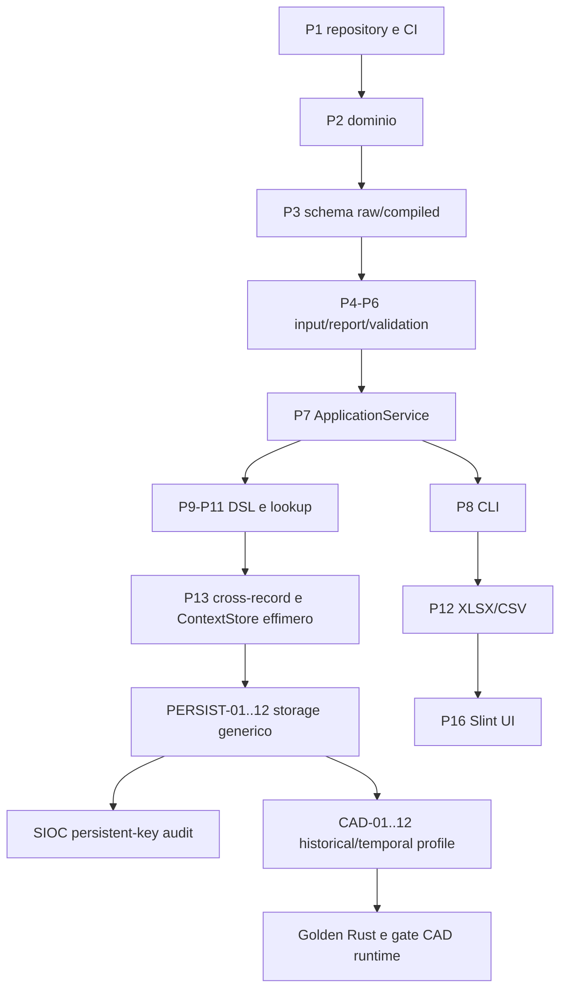

# Lintra — Percorso d'implementazione con persistenza core

**Task atomiche e sequenziali con un solo agente principale. Dopo verifica dei gate, avviare automaticamente la prossima READY secondo AGENTS.md; nessuna delega.** Gli identificativi P0–P18 precedenti sono invariati.

Le sequenze non impediscono di preparare i **tipi/trait** PERSIST nelle task P2/P3/P7 quando è nello scope; non significa anticipare backend o plugin. SIOC già include deduplicazione intra-trace in JSON FROZEN; tale controllo si può esercitare non appena sono pronti il compiler e il flow validator.

## Gate separati
- **Gate di documentazione:** questo kit contiene ARCH/DET/PLAN già riconciliati, verificabile offline.
- **Gate di implementazione storage:** T-PERSIST-01..12, test crash/restart/atomic commit/privacy.
- **Gate normativa SIOC:** PK intra-run già FROZEN; DEC-SIOC-HIST-01 open solo per enforcement cross-run.
- **Gate normativa CAD:** DRAFT/RELEASE_CANDIDATE finché non si compila e valida il profilo e non si chiude il gate umano.
