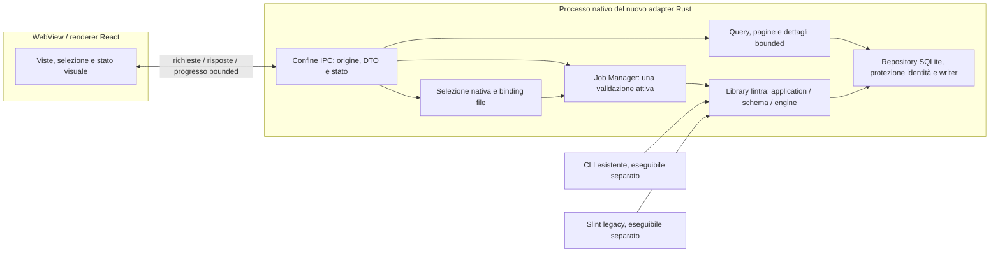
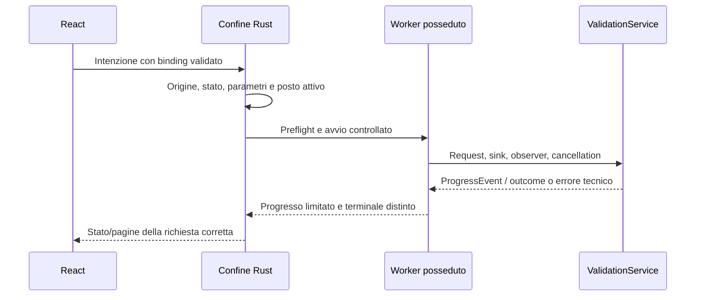

# Processo e ownership del nuovo adapter Tauri

T-MIG-P2-01,14 novembre2026. Trascrizione operativa delle decisioni già
ratificate in [ADR-MIG-001](../adr/ADR-MIG-001.md) e
[ADR-MIG-003](../adr/ADR-MIG-003.md), dopo [G-MIG-1](../verification/unified-post-m9/T-MIG-P1-06.md).
Non è una firma IPC finale: DTO, primitive e limiti si congelano aG-MIG-2.
Il bridge applicativo non è ancora implementato. Lo spikeP1 resta isolato.

## Processi e direzione delle dipendenze

Il diagramma separa responsabilità e confini, non promette un numero fisso di
processi OS del browser. WebView2 può avere processi renderer/network propri.
La library è chiamata in-process dal processo Rust; nessun server locale,
servizio HTTP, daemon o processo CLI invocato come backend viene introdotto.
CLI e Slint continuano a usare i propri entrypoint qualificati.

Il futuro package Tauri dipende dalla library. `domain`, `schema`, `engine`
e la library non dipendono dall’adapter o da Tauri. Nessun import di
`lintra-ui` per riusare controller che possiedono tipi Slint. Gli algoritmi
applicativi già pubblici si chiamano direttamente; il codice GUI legacy è
riferimento di comportamento e ownership, non una seconda library di dominio.

## Proprietà dei dati

| Oggetto | Proprietario | Cosa attraversa IPC |
| --- | --- | --- |
| File scelti, schema/versione, reference, encoding e binding richiesta | Rust, attraverso selezione nativa/preflight e controlli effettivi | Descrittori minimi e identificatori verificati, mai autorità ricavata da un path JS |
| ValidationRequest, parametri e servizi | Rust/job | Intenzione tipizzata; il renderer non compila né interpreta regole |
| Stream input, PASS1/PASS2, chiavi/PK, proiezioni e spool | Servizio Rust | Solo misure/progresso e pagine richieste, non file o indici interi |
| Risultato corrente e ultimo risultato concluso | Rust/job, con identità distinte | Esiti minimi correlati; un vecchio successo non diventa l’esito del nuovo tentativo |
| Report canonico e indice dei risultati | Rust; lifetime mantenuto durante query/export | Pagina/dettaglio bounded. Niente array globale di diagnostici in JS |
| Chiave HMAC, protector, repository e preparazione approvazione | Rust soltanto | Nessun segreto, token interno o oggetto deserializzabile che conceda approvazione |
| DOM, filtri richiesti e selezione visuale corrente | React | Valori text-only, minimizzati; nessuna PHI in storage web o log |

La pagina può mostrare i dettagli esplicitamente richiesti secondo ADR-MIG-003;
“PHI backend” non autorizza una cronologia nascosta nel DOM e non vieta i
diagnostici necessari alla vista corrente. Path, metadata e note sono testo
ostile anche quando normativamente validi. Vietati HTML/URL attivi da valori.
I controlli Rust restano necessari anche se il relativo pulsante è disabilitato.

## Collegamenti con il codice reale

| Responsabilità | Entry/type già esistente | Conseguenza per l’adapter |
| --- | --- | --- |
| LocalOnly e Full | `ValidationService::validate`, `validate_with_parameters`, `validate_with_typed_parameters` in `src/application/service.rs` | Costruire `ValidationRequest`, sink, observer e cancellation reali; niente nuovo motore in TS |
| Selezione del perimetro | `ValidationScope::Trace/Flow`, `ValidationMode` e `ValidationOptions` in `src/application/request.rs` | Distinguere scope da mode; mantenere Full multi-trace e max_errors originale |
| Progresso | `ProgressObserver::on_event(ProgressEvent)` in `src/application/progress.rs` | Callback sincrona nel worker; batching e scheduling UI appartengono all’adapter |
| Cancellazione e lifetime worker | `CancellationToken`; `WorkerHandle` in `ui/src/worker.rs` | Token cooperativo, progresso separato dal terminale, cancellazione e join espliciti; niente worker staccati |
| Risultati | `AnalysisReport`/`CompletedAnalysis`, `ReportIndex` in `ui/src/results/mod.rs` | Report posseduto e indice Rust; riusare la semantica senza importare Slint nel nuovo adapter |
| Stato autorevole | `ValidationRunOutcome`, `RunStatus`, `ValidationSummary::completeness()` | Non aggiungere Partial/Unknown a RunStatus per convenienza GUI: status, completezza ed evaluation sono dimensioni distinte |
| Storico | `HistoricalValidationService::validate/validate_text`, `HistoricalValidationOutcome` | `ValidationOnly` non concede preview/approval; nessun consenso sintetizzato dalla UI |
| Review e commit | `HistoricalReview` solo Serialize e servizi preview/review/CAS già qualificati | Un JSON di review non ricostruisce l’autorità Rust. Il flusso concreto va nei contratti P2/P7 |
| Output | `AtomicReportFile`/`ReportCompletion` in `src/report/atomic.rs` | Errori e Partial/Cancelled non pubblicano un report completo. File e DB non sono una transazione unica |
| Store e identità | `PersistentContextRepository`, `IdentityProtector` | Operazioni typed nel backend, nessun SQL generico o chiave nel renderer |

Questi nomi sono API/tipi reali. “Job Manager”, “broker” e “confine IPC”
indicano ruoli del nuovo adapter ancora da attuare nelle fasi autorizzate;
non sono nuove API dichiarate esistenti. `WorkerHandle` corrente appartiene a
Slint e non è un contratto IPC. Il servizio storico possiede borrow del
repository/protector: costruzione e lifetime devono restare coerenti nel
proprietario Rust, senza inviare riferimenti presi in prestito al renderer.

## Lifecycle e guasti

Non si prenota un secondo job per aggirare “una validazione attiva per istanza”.
Cancel richiede il token cooperativo e attende l’esito reale; un messaggio di
richiesta non prova cancellazione. Panic/disconnessione/errori tecnici non sono
CompletedValid né diagnostici normativi. Un terminale non deve perdersi perché
il canale del progresso è saturo. Le race, identità e ripetizioni si specificano
inP2-03/04, prima dell’implementazione del Job Manager inP4.

Chiusura della vista e shutdown non trasferiscono file o worker alla UI:
backend cancella/coordina e attende i propri lavori prima della pulizia dei
soli temporanei posseduti. Non cancella dati operatore o snapshot approvati.
Non promette che qualunque I/O o join finisca istantaneamente; blocchi fisici
e errori di cleanup devono restare esiti tecnici espliciti.

## Confini conservati

Una root privata per-account e file sotto controllo Rust; nessun DB mutabile
in Program Files. Niente shell/fs/SQL generici via IPC, rete applicativa,
telemetria, CDN, updater o nuovi algoritmi crittografici. Il confine UI non
sostituisce preflight, selezione dei file, controlli OS, CAS o C1. I limiti
wire/paging non possono troncare la validazione o alterare JSONL/audit.

G-MIG-2 deve ancora approvare il contratto completo. G-MIG-1 non autorizza
P3 anticipata, decommission Slint, release o uso di dati reali nei test.
