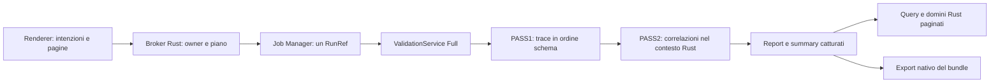

# Full multi-tracciato — P2-11, da approvare in G-MIG-2

15 novembre2026. Prerequisiti P2-03/05/08 DONE. Contratto pubblicato per il gate;
P2-11 non è DONE finché non viene approvato complessivamente. Il termine Full
indica ValidationMode::Full nello scope compilato, non una certificazione
clinica del flusso completo né implicita approvazione di uno storico.

## Input e piano immutabile

Il broker nativo Rust possiede configurazione, schema compilato con hash,
input scelti e parametri dichiarati. Renderer riceve solo configuration_ref,
plan_ref e trace_ref/parameter_ref opachi; i descrittori sono paginati64elementi,
non l’intero catalogo/dataset. Ogni modifica cambia la generazione del piano:
un token di input appartenente ad altro owner/schema/piano non può essere
riassociato a un trace. Selezione del path nativa, nessun path nel DTO.
InputSource::Path resta di Rust, anche con path OS non UTF-8 o contenenti '='.

Protocollo minimo versionato, sempre envelope ratificato P2-02:

| Operazione proposta | Payload DTO schemaVersion1 | Risposta essenziale |
|---|---|---|
| plan_input_choose | plan_ref, trace_ref | Nuovo plan_ref e stato assegnazione; scelta nativa |
| plan_parameter_set | plan_ref, parameter_ref, value DTO {schemaVersion,kind,text} | Nuovo plan_ref; errori senza echo del valore |
| plan_prepare | plan_ref | prepared plan_ref, mode, ready; preflight autorevole Rust |
| validation_start | plan_ref preparato, mode local_only/full | RunRef schemaVersion1; un run per l’intero bundle |
| validation_state/validation_cancel/validation_acknowledge | RunRef | Snapshot/intenzione/esito secondo LIFECYCLE.md |
| risultati/progresso/export | RunRef/handle nei contratti P2-04..07 | Pagine/metadati, mai input o report massivi |

value.kind è text/integer e deve corrispondere al ParameterDefinition catturato.
L’intero è testo esatto convertito da Rust in IntegerLiteral/JoinParameterValue,
non Number JS o una coercizione fra tipi. Nessun parametro namespace/default
viene inventato; manca/sconosciuto/tipo errato fallisce secondo il servizio.
Payload ammessi solo con i campi elencati, DTO annidati versionati e scope
owner/generazione nativi. `ready` è un risultato Rust, mai un flag del client.

ValidationRequest reale usa FlowValidationInput di TraceValidationInput,
ValidationScope::Flow e ValidationMode::Full. Full su Trace scope, bundle vuoto,
trace sconosciuto/duplicato, path vuoto, trace obbligatorio assente, parametro
non valido e max_errors=0 falliscono prima di aprire gli input di validazione.
Riutilizzare preflight_flow_inputs/VerifiedRunContext e
ValidationService::validate_with_typed_parameters; il vecchio preflight
Trace/LocalOnly rifiuta Full e non è un sostituto.

Trace disponibili e richiesti derivano dal compiled plan e dalle policy di
availability: non dall’estensione/nome file o da una lista hardcoded SIOC/CAD.
Non si converte un input obbligatorio assente in file vuoto o run LocalOnly.
L’assenza di una fonte opzionale conserva gli esiti Unknown/Partial previsti.
Se lo schema richiede contesto storico, si usa il servizio autorizzato reale
quando disponibile; in sua assenza errore esplicito, niente omissione dei
controlli o fallback audit-only. PERSIST/approve/C1 non sono endpoint MIG.

I path nativi restano path fino alle aperture controllate del servizio.
Il contratto non promette di congelare i byte sul disco al momento del picker:
modifiche esterne seguono le garanzie input/audit reali e i loro errori. Gli hash
sono quelli osservati dal run, non inventati in UI. Nessuna seconda copia bulk.

## Ownership e ciclo di vita

Un CancellationToken e un worker posseduto per l’intero bundle, non run
indipendenti da fondere in JS. Schema/reference, parametri tipati, opzioni,
spool e audit sono catturati insieme. Rust esegue PASS1/PASS2 e riconcilia
conteggi/reclassification una sola volta. Progressi per trace e pass non
diventano una percentuale falsa o una nuova run. Terminale solo dopo join e
finalizzazione di sink/report: ProgressEvent::RunCompleted non basta.

La cancellazione resta richiesta finché il servizio non conclude; conserva
audit parziali osservati senza inventare EOF/digest completi. Truncated è
Partial e non esportabile. Errore reference/I/O/sink/worker resta tecnico,
non CompletedValid/Invalid. Nuovo piano/run non cambia il report vecchio:
last_report consultabile solo con identità e provenienza esplicite.

## Risultati e report

Terminale/outcome come P2-03: RunStatus esistenti completed_valid,
completed_invalid, cancelled; completeness complete/partial separata, truncated
e report_available espliciti. Nessun FullStatus alternativo. VALID+Partial
con Unknown non dimostra conformità completa; una pagina senza diagnostici
non prova VALID. ScopeSummary::Flow, ordine trace, audit input/hash, parametri,
reference evidence, controlli/not_applicable/unknown restano nella summary
Rust fedele. Descrittori/controlli voluminosi si consultano a pagine64 tramite
handle del report, non serializzando l’intera summary in un messaggio.

JSONL resta in ordine canonico servizio: trace/riga/regola senza merge/sort JS.
P2-05 applica filtri esatti AND e ordine relativo, P2-06 risolve guida/domini
dal trace selezionato anche in Full. L’export cattura report+summary della
stessa run e protegge **tutti** gli input del bundle contro collisioni di file
finali e staging. Il vecchio helper Slint che protegge input_path singolo deve
essere adattato a questo insieme prima di qualificare l’export Full.
Writer normativi invariati, receipt per-file, nessuna transazione multi-file/DB.

## Matrice di accettazione

full-cases.json associa scenari positivi, negativi e race ai test Rust reali
già esistenti e ai contratti P2. Include valid/invalid cross, namespace e
duplicati, input necessari, Unknown/Partial/N/A, reference per trace, cancel
in ogni pass, errori sink e audit, path non UTF-8 e collisioni multi-input.
La verifica locale risolve gli anchor e i digest, e passa gli esempi DTO nel
codec comune: è evidenza di design, non nuova esecuzione Full nativa.
Le reference P2-03/04 già qualificate restano valide se sorgenti invariati;
non si ripetono solo per pubblicare questa matrice.

P2-11 richiede l’approvazione nel gate G-MIG-2. Adapter Rust, TS, worker reali,
test di bundle e parity nativa rimangono nei task implementativi del piano,
senza autorizzare nuove norme, approval storica o rilascio prima diG-REL.
