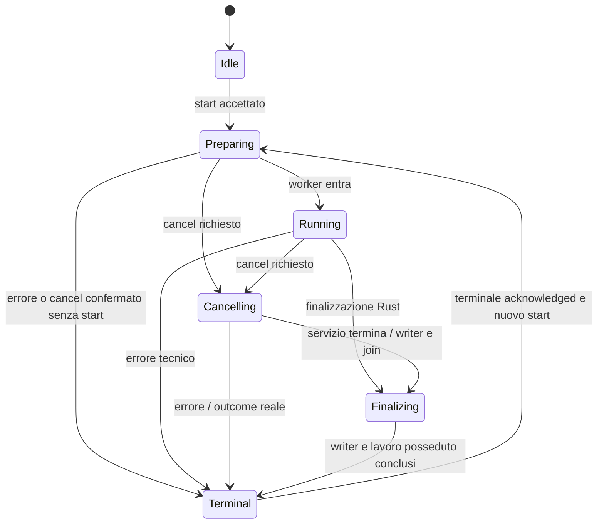

# Identità, ownership e lifecycle del run

T-MIG-P2-03,14 novembre2026. Specifica di design collegata al
[wire ratificato](CONTRACT.md) e all’[ownership](../TAURI_PROCESS_OWNERSHIP.md).
Le scelte implementative ordinarie sono autorizzate dalla ratificaP2-02;
G-MIG-2 resta aperto. La [reference](lifecycle_reference.py) non è un Job Manager
Tauri già implementato. Le sue transizioni sono atomiche nel modello;
lock/atomiche e test con veri thread appartengono aP4/P7.

## Identità e binding

```json
{"schemaVersion":1,"instance_id":"aaaaaaaaaaaaaaaaaaaaaaaaaaaaaaaa","run_id":"1"}
```

RunRef ha esattamente questi tre campi. `instance_id` è un nonce128bit del
backend, codificato32hex minuscoli, nuovo una volta per istanza applicativa
con entropia OS. Non è una chiave HMAC o una credenziale; la reference inietta
un valore sintetico. `run_id` è un contatore backend u64 positivo, testo
decimale canonico senza zeri iniziali. Mai wrap/reuse; overflow fallisce prima
di sostituire uno stato. Restart cambia instance_id e invalida i vecchi handle.
Il contatore appartiene all’applicazione, non viene resettato per trace o vista.

Il proprietario è il contesto finestra nativo verificato, con identità di
creazione, non un owner passato dal renderer o la sola stringa di label.
Ogni richiesta verifica il proprietario prima della consultazione del run.
Un RunRef valido sintatticamente non concede authority. Nessun riferimento
Rust preso in prestito, file descriptor, path o materiale chiave entra nel DTO.

Un run appartiene a un piano backend immutabile verificato: schema/versione,
mode, input selezionati e reference restano quelli catturati. `plan_ref` è un
handle opaco; il renderer non sostituisce quei binding con stringhe nuove.
Full multi-trace usa **un solo run_id per l’intero bundle**, non una validazione
per trace o per PASS. L’esatta shape del piano Full restaP2-11; la reference
assume che il broker abbia già verificato il piano e il suo mode.

`request_id` correla un comando, RunRef correla il lavoro. Un retry di start
non è implicitamente idempotente: duplicati in-flight incontrano il posto
occupato; il riuso immediato dell’ultimo request_id di start è rifiutato.
Non si conserva un registro illimitato di tutti gli ID. Dopo risposta persa
si legge lo stato corrente, invece di ripetere alla cieca un’operazione.

## Operazioni progettuali e DTO

Questi sono nomi del registry da implementare dopo il gate, non API esistenti
nel probeP1 o nuovi entrypoint pubblici della library.

| Operazione | Payload versionato | Risultato |
| --- | --- | --- |
| start_validation | schemaVersion1, plan_ref | RunRef del piano backend, dopo prenotazione atomica del posto |
| get_run_state | schemaVersion1, run opzionale | Snapshot autorevole corrente; run omesso permette risincronizzazione dopo reload/risposta persa |
| cancel_validation | schemaVersion1, run | DTO schemaVersion1/run/disposition: requested, already_requested, too_late, already_terminal |
| acknowledge_terminal | schemaVersion1, run | Conferma idempotente della ricezione del terminale, non approvazione normativa o storica |

RunRef estraneo/precedente è IPC_STALE_CONTEXT; owner estraneo IPC_UNAUTHORIZED.
Campo/tipo/forma illegale è errore di protocollo. Nessuna operazione IPC può
chiamare enter_worker, service_completed, finish_validation o fail: sono segnali
interni del producer Rust. Il registro non espone PERSIST/approve o SQL generico.

Lo snapshot ha schemaVersion1, RunRef, plan_ref, mode, state, cancel_requested,
outcome. Idle ha run/outcome null. Gli outcome sono DTO schemaVersion1:

- validation: status `completed_valid`/`completed_invalid`/`cancelled`,
  completeness `complete`/`partial`, truncated e report_available;
- technical_failure: error DTO versionato, category technical e codice fisso;
  nessun RunStatus inventato;
- not_started/reason cancelled: annullamento confermato prima dell’ingresso
  del worker, senza fabbricare un outcome/summary della library.

Non si introduce un boolean globale “conforme”. CompletedValid con completezza
Partial non è una conformità Full completa; Unknown rimane evaluation non
definitiva nella sorgente Rust, non viene ridotta a false o cancellata dal DTO.
Report disponibile non equivale ad approvazione di uno snapshot persistente.

## Macchina degli stati



| Stato | start | cancel | ingresso/eventi worker | terminale | ack |
| --- | --- | --- | --- | --- | --- |
| idle | preparing dopo binding e posto libero | stale senza RunRef corrente | stale | stale | stale |
| preparing | busy | cancelling; non prova annullamento | enter→running, oppure resta cancelling se richiesto | errore tecnico; not_started solo con conferma che il worker non è entrato | invalid_state |
| running | busy | cancelling | finalizing o RunCompleted→finalizing | errore tecnico; risultato di validazione richiede confine servizio effettivo | invalid_state |
| cancelling | busy | idempotente | enter non perde il token; finalizzazione→finalizing | outcome reale, errore o not_started solo prima dell’ingresso | invalid_state |
| finalizing | busy | request prima del confine servizio; too_late dopo | RunCompleted sigilla il servizio, non pubblica il terminale UI | dopo worker/writer/join reali, oppure errore tecnico | invalid_state |
| terminal | invalid_state finché non acknowledged, poi nuovo run | already_terminal | aggiornamenti produttore duplicati invalid_state | immutabile: nessun secondo terminale | idempotente |

L’ack non cancella uno storico o autorizza C1: evita che un nuovo start faccia
sparire un terminale mai osservato. Un reload dello stesso contesto nativo può
risincronizzarsi con get_run_state. Una nuova finestra con identità nativa
nuova non eredita authority dal nome; chiusura richiede cancellazione, attesa
reale del lavoro posseduto e cleanup dei soli temporanei, senza worker staccati.
Il processo non promette join o I/O istantanei.

## Esiti e finalizzazione contro il codice reale

ValidationService local e Full controllano CancellationToken in finalizzazione,
finiscono audit e summary, inviano la summary al sink, emettono RunCompleted e
restituiscono ValidationRunOutcome. Il callback non porta un esito normativo
al renderer. Il worker legacy esegue ancora sink.finish, verifica schema e
pubblica AtomicReportFile: possono fallire dopo il completamento del servizio.
Il nuovo supervisor deve pubblicare il terminale solo dopo il risultato reale
del lavoro posseduto e la sua conclusione/join, senza bloccare l’event loop UI.

Cancel richiesto non modifica un outcome già fissato. Anche una richiesta
precedente al RunCompleted osservabile può arrivare dopo l’ultimo checkpoint
letto dal core: il risultato reale resta autorevole. Un errore di writer,
pubblicazione, schema cambiato, panic o disconnessione è technical_failure,
mai CompletedValid/CompletedInvalid. Un errore può avere effetti filesystem
già registrati nel receipt: nessuna transazione/rollback globale viene promessa.

Cancelled e truncated implicano completezza Partial e nessun report completo
pubblicato. Partial senza truncation può avere report canonico consultabile;
il suo contenuto e le valutazioni restano quelli effettivi. La reference
rifiuta combinazioni producer impossibili come errore tecnico. La validità
della completezza è calcolata dal Rust reale, non dal modello Python o dal JS.

## Race e conservazione

| Interleaving | Esito obbligatorio |
| --- | --- |
| due start concorrenti | una prenotazione, secondo busy, nessuna coda di validazioni |
| cancel prima di entrare / ingresso prima della conferma cancel | not_started solo nel primo caso; nel secondo attendere il core |
| cancel ripetuto | token idempotente, nessun secondo worker |
| cancel contro ultimo checkpoint / RunCompleted | richiesta non prova cancellazione; outcome reale, too_late dopo il confine osservato |
| RunCompleted contro errore flush/publish | terminale tecnico, mai successo anticipato |
| terminale contro nuovo start | rifiutare sostituzione fino all’ack; nuovo run ottiene ID nuovo |
| callback/evento del run vecchio contro run nuovo | reject/drop prima di mutare lo stato nuovo |
| query/cancel da altra finestra | unauthorized, senza dati né mutazioni |
| risposta persa o reload | leggere lo stato autorevole corrente; niente retry start implicito |
| restart / contatore u64 esaurito | vecchi riferimenti stale; niente wrap o riuso |
| chiusura contro completamento | rifiutare nuovi start e attendere esito/cleanup; non inventare Cancelled |
| errore/cancel nuovo contro report precedente | esito corrente distinto; il report precedente mantiene la propria identità |

Il manager mantiene un solo record corrente e un solo riferimento all’ultimo
report pubblicato, non una lista di risultati/record. Un nuovo errore o cancel
non fa diventare quel vecchio report l’esito corrente. File/indici e pin di
query rimangono Rust e sono limitati dai contrattiP2-05/06/08. I dati permanenti
e gli snapshot approvati non vengono eliminati da questa policy temporanea.

La reference controlla53casi con expected espliciti e round-trip del DTO nello
stesso envelope P2-02. Non prova scheduling di thread o trasporto Tauri:
verifiche reali rimangono ai taskP4/P7 e ai gate previsti.
