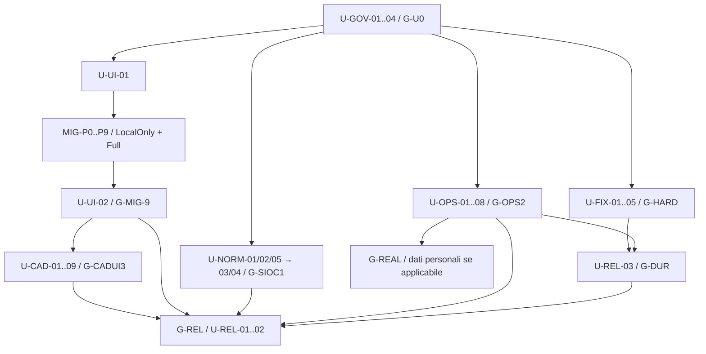

# Dependency map post-M9

Autorità: master v1.0 §§6–10 e ratifica del 10 novembre 2026.
[Registro completo dei 128 nodi](DEPENDENCY_GRAPH.json): 39 U-* + 89 MIG,
prerequisiti originari preservati. Unico arco integrativo di ingresso:
U-UI-01 → T-MIG-P0-01, come sequenza esplicita del mandato. Non rinumera task.

Il diagramma sintetizza famiglie, non sostituisce le dipendenze per-ID nel JSON.
U-NORM-05 segue U-NORM-01; U-NORM-03 richiede 01+02+05, poi 04.
U-REL-01 richiede UI02+CAD09+NORM04+OPS08, U-REL-02 richiede
REL01+OPS06+REL03. G-REL ha inoltre tutti i gate aggregati e il signoff.
Nessuna dipendenza circolare CAD→MIG: gli esiti CAD/SIOC richiesti dalla
consegna finale si verificano nel gate G-REL, non si fingono parte del cutover MM9.

Se manca una prova Windows11 clean-room, una capability non è qualificata o
un caso normativo è dubbio, segnare solo la task dipendente e proseguire con
la prossima READY indipendente. CI Ubuntu/Windows non è una VM Windows11
pulita con installer offline provato. Nessun gate non eseguito diventa PASS.
G-REAL è separato e circoscritto. Le 140 task e milestone M9 originali non cambiano.

Ogni task ha dossier docs/verification/unified-post-m9/<ID>.md solo quando
avviata: un file vuoto per task futura non sarebbe evidenza. Stato in root
UNIFIED_IMPLEMENTATION_STATUS.md; verifica struttura con
`python3 scripts/check_unified_plan.py`.
